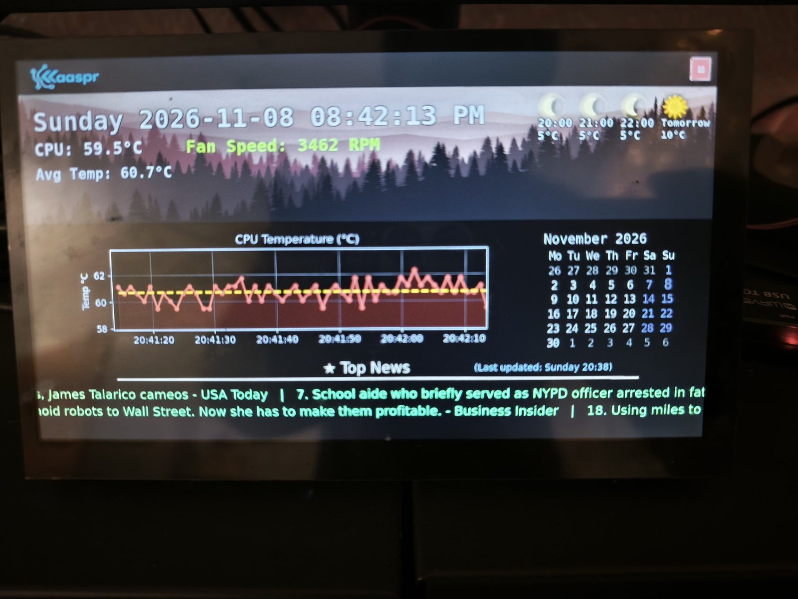

# Fanclock

A full-screen dashboard for the **Raspberry Pi 5**, written in Python with Tkinter and Matplotlib.
It controls a PWM cooling fan from the CPU temperature, and shows the clock, a calendar, the local
weather and scrolling news headlines over rotating landscape backgrounds, with a few playful animations.



## Features

- **Fan control:** reads the CPU temperature and drives a fan on **GPIO 18** with PWM (1 kHz).
  Automatic curve: off below 45 °C, 20–100 % between 45 and 70 °C, full speed above 70 °C.
  Manual override slider (0–100 %) and an **Auto** button.
- **System info:** CPU temperature, average temperature and fan RPM (from the Pi 5's `cooling_fan` hwmon).
- **Live CPU temperature chart** with the running average drawn as a dashed line.
- **Clock and calendar** with today highlighted.
- **Weather:** the next 3 hours and tomorrow (min/max, sunrise/sunset), with day/night icons. Shows an offline icon when unreachable.
- **News ticker:** world and technology headlines, refreshed every 30 minutes.
- **Backgrounds:** every image in `assets/backgrounds/` is shown in turn, with fade transitions.
- **Fireworks:** click anywhere on the dashboard for a rocket and fireworks show.
  Code for a hot-air balloon and a pirate ship animation is included but currently not switched on.
- **Full screen:** starts full screen; **F11** toggles it and **Esc** leaves it.
- **Message trigger:** `String_trigger_script.py "text"` shows any message with a fireworks show
  (for example from a cron job, Home Assistant or over SSH).
- **Scheduled show (optional):** a message and fireworks at fixed times of day, set in `config.json`.

## Data sources: no API keys needed

| Data | Service | Key | Notes |
|---|---|---|---|
| Weather | [Open-Meteo](https://open-meteo.com) | none | Free for non-commercial use |
| News | Google News RSS (world and technology topics) | none | Public RSS feeds |

Nothing in this repository requires an account, token or paid plan.

---

## Repository layout

```
PiDashboard/
├── fan_clock_display.py              # the dashboard
├── String_trigger_script.py          # send a message to the running dashboard
├── generate_weather_icons.py         # (re)creates assets/weather_icons/*.png
├── fan_clock_display_servicestart.sh # waits for internet, then starts the dashboard
├── fanclock.service                  # systemd unit for autostart
├── config.example.json               # copy to config.json and edit
├── requirements.txt
├── assets/
│   ├── backgrounds/                  # landscape backgrounds, any .png/.jpg (see "Image credits")
│   ├── images/                       # hotairballon.png, icon.png, kaaspr.png (AI-generated)
│   └── weather_icons/                # created by generate_weather_icons.py
├── docs/dashboard.jpg                # photo used in this README
└── README.md
```

---

## How it works

- **Tkinter** draws the window. The main loop is driven by `root.after(...)` timers rather than
  `sleep`, so the window stays responsive: the system info refreshes every second, the news
  scrolls continuously and the backgrounds rotate.
- **Matplotlib** is embedded in the window (`FigureCanvasTkAgg`) to render the calendar and the
  news ticker.
- **Fan control:** the CPU temperature comes from `/sys/class/thermal/thermal_zone0/temp`.
  `temp_to_speed()` maps it to a duty cycle, and `RPi.GPIO` PWM on GPIO 18 drives the fan
  (through a transistor or MOSFET, never directly from the pin).
- **Weather:** a single HTTP request to Open-Meteo returns hourly and daily forecast data for
  the configured latitude and longitude; WMO weather codes are mapped to the icons.
- **News:** `feedparser` reads the Google News RSS feeds.
- **Message trigger:** a background thread checks `flag.txt` every 2 seconds. When it contains
  text, the dashboard shows it with fireworks and clears the file.

On startup the weather and news are fetched before the first frame is drawn, so the window may
stay white for a few seconds on a slow connection.

---

## Hardware

- Raspberry Pi 5 (also runs on a Pi 4) with Raspberry Pi OS (Bookworm, desktop)
- A display (the layout targets a wide screen)
- Optional: a PWM fan on **GPIO 18**, switched through a transistor or MOSFET

---

## Installation

### 1. System packages

```bash
sudo apt update
sudo apt install -y git python3-tk python3-pil python3-pil.imagetk python3-requests \
                    python3-feedparser python3-matplotlib python3-numpy python3-rpi-lgpio
pip3 install tkcalendar --break-system-packages
```

On a Pi 5, `python3-rpi-lgpio` provides the `RPi.GPIO` API (the original RPi.GPIO does not
support the Pi 5).

### 2. Get the code

```bash
git clone https://github.com/ashwinprakashk/Fanclock.git ~/Fanclock
cd ~/Fanclock
```

### 3. Configure

```bash
cp config.example.json config.json
nano config.json
```

| Key | Meaning |
|---|---|
| `latitude`, `longitude` | Location for the weather forecast |
| `scheduled_show.enabled` | `true` to run a message and fireworks at set times |
| `scheduled_show.times` | List of `"HH:MM"` times (24 h) |
| `scheduled_show.message` | Text shown during the scheduled show |

`config.json` is listed in `.gitignore`, so your location never ends up on GitHub.
Without it, the defaults in `fan_clock_display.py` are used.

### 4. Run

On the Pi's desktop:

```bash
python3 fan_clock_display.py
```

Over SSH, tell it to use the Pi's screen:

```bash
DISPLAY=:0 python3 fan_clock_display.py
```

Close it with the **✖** button in the top bar. That also stops the fan PWM and releases the GPIO.

### 5. Send a message

```bash
python3 String_trigger_script.py "Dinner is ready!"
```

---

## Autostart with systemd

`fanclock.service` starts `fan_clock_display_servicestart.sh`, which waits for internet and then
launches the dashboard on the desktop (`DISPLAY=:0`).

```bash
chmod +x fan_clock_display_servicestart.sh
sudo cp fanclock.service /etc/systemd/system/
sudo systemctl daemon-reload
sudo systemctl enable --now fanclock
```

If your user is not `pi5` or the code is not in `~/Fanclock`, edit `User=`, `XAUTHORITY=`,
`WorkingDirectory=` and `ExecStart=` first.

```bash
systemctl status fanclock          # running?
journalctl -u fanclock -f          # live log
sudo systemctl stop fanclock       # stop it before starting a copy by hand
```

---

## Troubleshooting

| Problem | Fix |
|---|---|
| `lgpio.error: 'GPIO not allocated'` or `GPIO busy` | Another copy is already running and holds GPIO 18. Check with `pgrep -af fan_clock_display`; stop it with `sudo systemctl stop fanclock` or `pkill -f fan_clock_display.py`. |
| `no display name and no $DISPLAY environment variable` | Started over SSH: use `DISPLAY=:0 python3 fan_clock_display.py`. |
| `Authorization required` | Add `XAUTHORITY=/home/<user>/.Xauthority`. |
| White window for a while | It is waiting for the weather and news requests. Check internet access. |
| Weather shows the offline icon | Open-Meteo unreachable: `curl -I https://api.open-meteo.com` |
| Fan RPM shows an error | No fan tachometer found under `/sys/devices/platform/cooling_fan/hwmon`; normal without the official Pi 5 fan. |

---

## Image credits and disclaimer

**AI-generated artwork (by the author):** `assets/images/` (`hotairballon.png`, `icon.png`,
`kaaspr.png`) and `assets/weather_icons/` (created by `generate_weather_icons.py`).

**Background images (`assets/backgrounds/`) are not the author's work.** They were collected for
personal, non-commercial use, mainly from [Vecteezy](https://www.vecteezy.com) (free vector
landscapes) and from Pinterest. The original artists could not be identified for every image.

- All rights to these images remain with their respective creators.
- Images from Vecteezy are used under the Vecteezy license; **credit: Vecteezy.com**.
- They are included only so the dashboard works out of the box. They are not covered by this
  repository's license and may not be reused from here.
- If you are the creator of one of these images and want it credited differently or removed,
  please open an issue and it will be taken care of promptly.

To use your own backgrounds, put any `.png` or `.jpg` files into `assets/backgrounds/`. All images
there are shown in turn, sorted by name; a wide aspect ratio such as 1920×600 looks best. If the
folder is empty, the dashboard uses a plain dark background.

Weather data by [Open-Meteo.com](https://open-meteo.com) (CC BY 4.0). News headlines via Google News RSS.
